<div align="center">

# PROJECT ZERO

**A cinematic, scroll-directed WebGL portfolio.**<br/>
*Every system begins with a single decision. Mine was to build.*

[](https://www.typescriptlang.org/)
[](https://threejs.org/)
[](https://vite.dev/)
[](https://vitest.dev/)
[](https://www.khronos.org/webgl/)

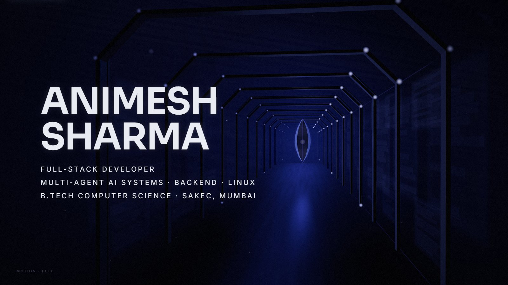

</div>

---

## About

**PROJECT ZERO** is the portfolio of **Animesh Sharma** (full-stack developer: multi-agent AI systems, backend, Linux). It is built as a short film instead of a website.

There are no cards, grids, skill bars or navbars. Scrolling directs the camera through nine authored scenes. Each project is told as a world: the problem is *felt* first, the system that solves it assembles itself on screen, and only then does the title resolve out of the fog.

One recurring object, the **signature**, travels through the whole film. It evolves after every project and carries every transition.

The whole experience was designed before any code was written, in seventeen pre-production bibles (art direction, cinematography, motion, lighting, interaction, performance and more) that live in [`PROJECT_ZERO_PREPROD/`](PROJECT_ZERO_PREPROD).

<div align="center">
  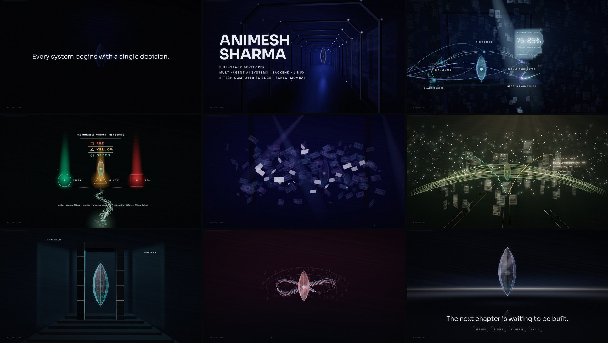
  <sub><i>The film, in order: Boot · Identity · LawLens-X · Triage Assistant · Workplace Operations Agent · BenefitBridge · Mavira OS · Personal Health Coach · Ending</i></sub>
</div>

---

## The film

| # | Scene | What the world shows |
|:-:|---|---|
| 0 | **Boot** | Black void. Two sentences resolve from fog to ink, then dissolve into dust absorbed by a quiet seed. |
| 1 | **Identity** | A corridor of floating architectural frames, the name, three role lines and a quiet *Journey* hint. |
| 2 | **LawLens-X** | Thousands of contract pages, one red clause, a fracture, then five agents rebuilding the analysis and streaming results. |
| 3 | **Triage Assistant** | A heartbeat in the dark. Unstable pathways collapse, retrieval locks, and Red / Yellow / Green thresholds lock with shape cues. |
| 4 | **Workplace Operations Agent** | Email, Slack and calendar fragments collide, then order onto three deterministic rails feeding a grading nucleus. |
| 5 | **BenefitBridge** | Isolated points of light in fog become a woven eligibility lattice, with user and admin arcs and request corridors. |
| 6 | **Mavira OS** | Contained glitches, boot strata sliding into alignment, a hardened kernel assembling, AppArmor barriers and a single Fail2Ban flare. |
| 7 | **Personal Health Coach** | Cold memory shards compress into folds, then into one warm continuous knowledge ribbon. |
| 8 | **Ending** | The completed signature, *"The next chapter is waiting to be built."*, Résumé · GitHub · LinkedIn · Email. |

## Gallery

<table>
  <tr>
    <td width="50%">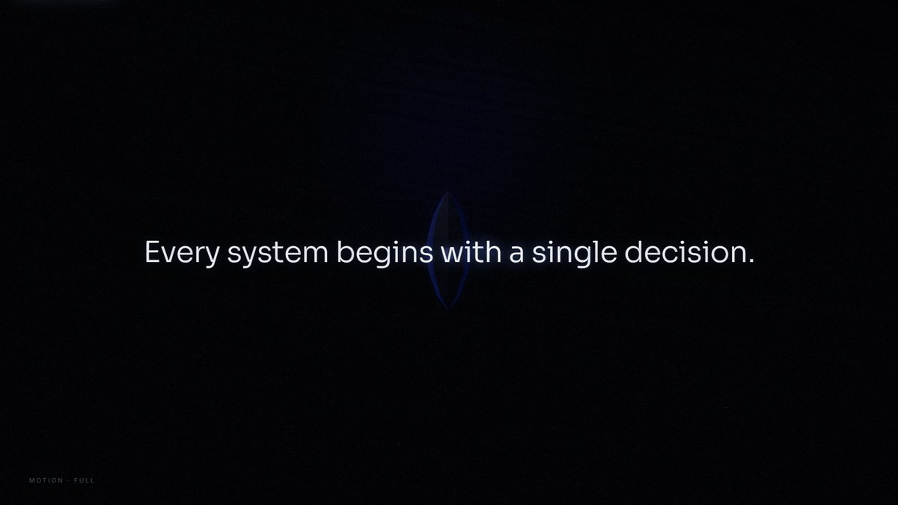<br/><sub><b>Boot.</b> Type resolves fog-to-ink; it never slides.</sub></td>
    <td width="50%">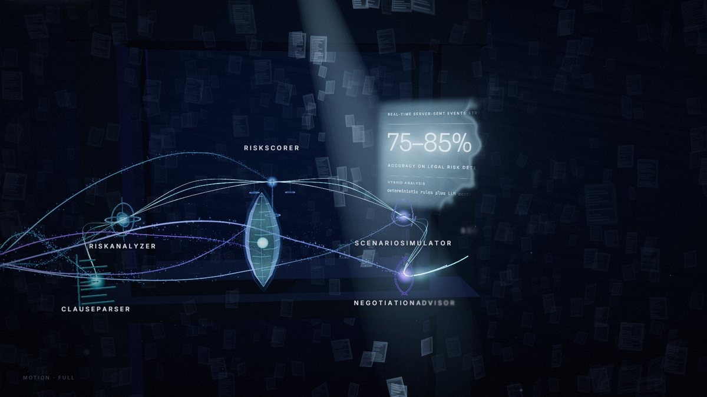<br/><sub><b>LawLens-X.</b> Five agents rebuild the analysis; the SSE stream flows into the output wall.</sub></td>
  </tr>
  <tr>
    <td>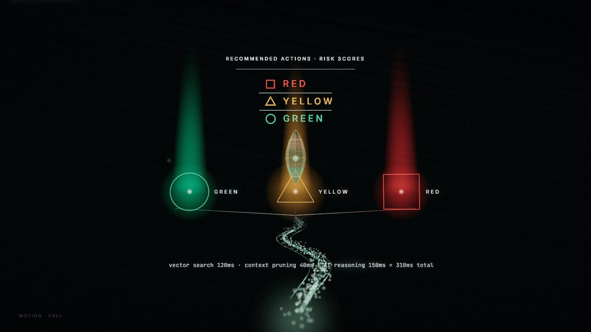<br/><sub><b>Triage Assistant.</b> Thresholds lock with shape and label cues, never colour alone.</sub></td>
    <td>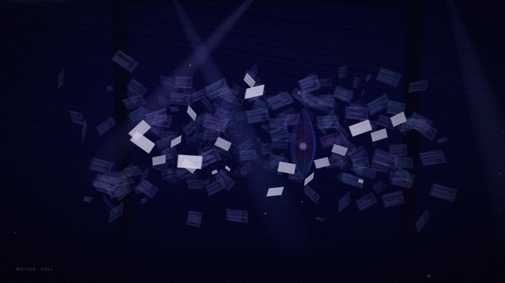<br/><sub><b>Workplace Operations Agent.</b> Chaos and collision before deterministic order.</sub></td>
  </tr>
  <tr>
    <td>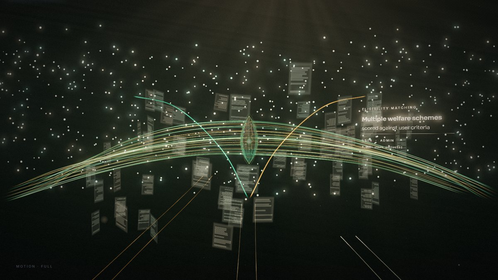<br/><sub><b>BenefitBridge.</b> Eligibility paths ignite across a woven lattice.</sub></td>
    <td>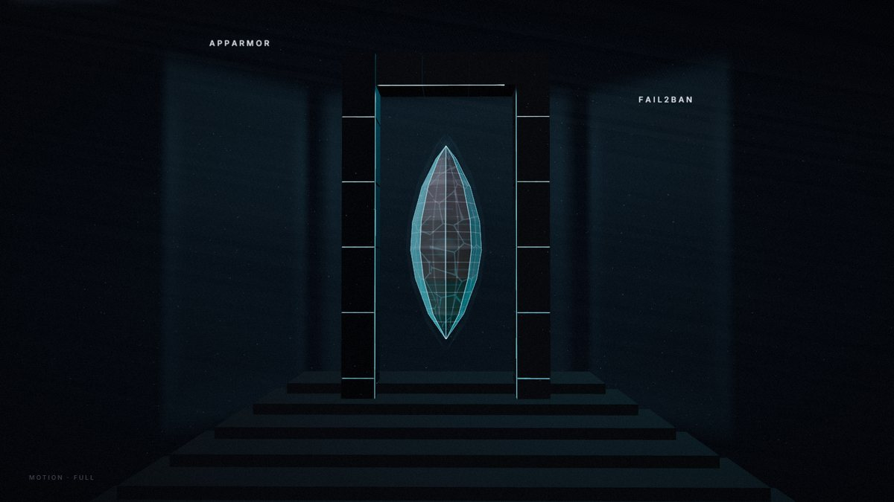<br/><sub><b>Mavira OS.</b> The kernel assembles; translucent barriers hold.</sub></td>
  </tr>
  <tr>
    <td>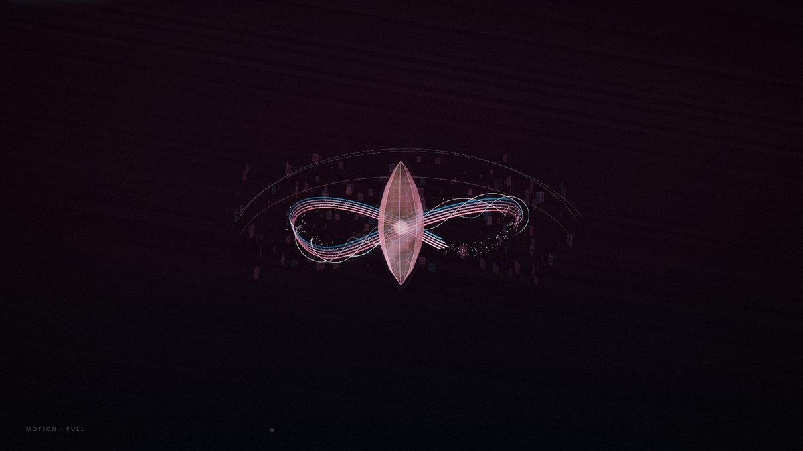<br/><sub><b>Personal Health Coach.</b> Compressed memories become one continuous ribbon.</sub></td>
    <td>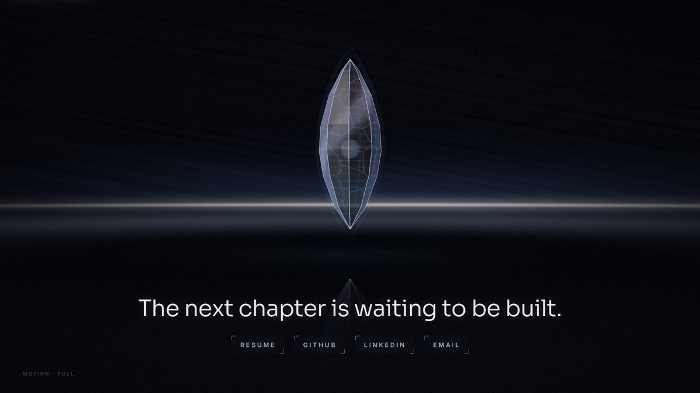<br/><sub><b>Ending.</b> Silence, one sentence, four understated links.</sub></td>
  </tr>
  <tr>
    <td>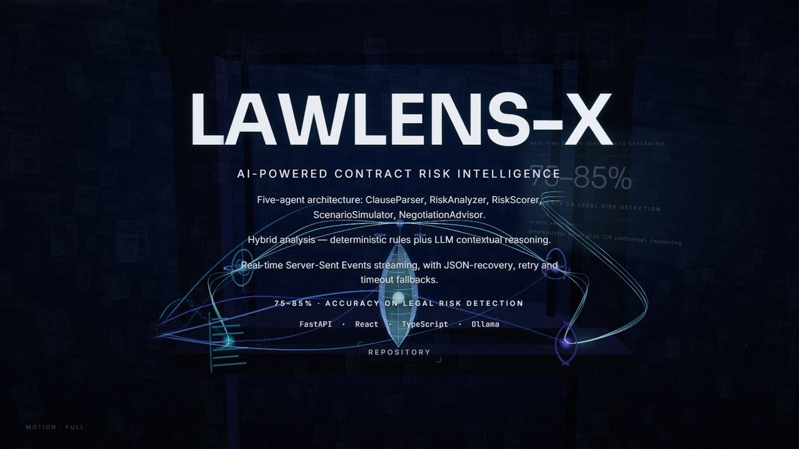<br/><sub><b>Title climax and dossier.</b> Information arrives only after the emotion.</sub></td>
    <td>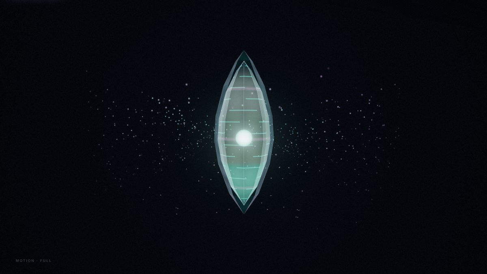<br/><sub><b>Transition.</b> Inside the fog, the signature becomes the lens between worlds.</sub></td>
  </tr>
</table>

---

## Highlights

- **A director, not a scroll page.** Native scroll drives a timeline of scene and transition bands. Progress is damped with a per-segment rate limit, so fast scrolling still plays every beat. Home and End become fog cuts with cinematic catch-up.
- **The signature object.** A faceted *Neural Core Monolith* evolves through nine states (SOC-0 → SOC-8). Its material shifts across stone, alloy and energy glass, and its internal channels accumulate with each project: clause segments, threshold chambers, rails, web veins, kernel seams and a ribbon.
- **Transitions that transform the world.** Fog spikes F2 → F3 → F1. The camera pushes into the boundary, the signature becomes an absorbing lens on the optical axis, and worlds swap at peak fog in one of three styles: *Absorb*, *Dissolve* or *Collapse-Passage*.
- **Typography as architecture.** Real DOM text emerges fog-to-ink, per glyph, with a sweeping light pass, at one style write per frame. When it dissolves, **GlyphDust** rasterises the glyphs into WebGL particles that the signature absorbs.
- **Cinematography.** Keyframed shot tracks per scene, lens-based FOV, depth-of-field on volumetric particles (bokeh focus pulls), restrained bloom, and a film grade with lifted blacks and grain.
- **Everything is procedural and sourced.** There are no stock assets. Every number and claim on screen comes from the résumé and the public repositories.

## Tech stack

| Layer | Choice |
|---|---|
| Rendering | three.js r186 (WebGL2), custom GLSL (simplex/fbm noise, fog, bokeh points, energy tubes, instanced panes) |
| Post-processing | EffectComposer: UnrealBloom → OutputPass (ACES) → custom grade (vignette, grain, lifted blacks) |
| Language & build | TypeScript (strict), Vite 8 with lazy per-scene chunks |
| Typography | Sora · Inter · JetBrains Mono (self-hosted via `@fontsource`) |
| Quality | Vitest, ESLint (typescript-eslint), headless Edge/Chrome via `playwright-core` for smoke tests and keyframe capture |
| Deployment | Static output; `vercel.json` included |

## Architecture

```
ExperienceRoot ─ render loop · scene streaming · transition blending
├─ Directors     Scroll · Camera · Lighting · Fog · Input · Accessibility · Quality
├─ Systems       Signature · Sky · FogVolume · AmbientMotes · MorphPoints · GlyphDust ·
│                ArchitectureViz (EnergyLines, Panes, HoloPlane, Glow, LightBeam) · PostFX
├─ UI            CinematicTextLayer · PortalButtons · MinimalOverlay
└─ Scenes        Boot · Identity · LawLens-X · Triage · Workplace · BenefitBridge · Mavira · HealthCoach · Ending
```

Each scene implements a small contract (`prepareAssets · enter · update · exit · cleanup`) and writes *directives* every frame: camera shot, sky, lighting, fog, signature state, particles and bloom. The orchestrator blends neighbouring scenes' directives through each transition and hands them to the directors. Scene state is derived purely from progress, so scrolling backwards reverses everything exactly.

Read more in [`docs/ARCHITECTURE.md`](docs/ARCHITECTURE.md). To build or extend a scene, see [`src/experience/scenes/AUTHORING.md`](src/experience/scenes/AUTHORING.md).

## Getting started

Requires **Node.js 20.19+ or 22.12+** and a WebGL2-capable browser.

```bash
git clone https://github.com/AnimeshhXD/PortfolioZero.git
```

```bash
cd PortfolioZero
```

```bash
npm install
```

```bash
npm run dev
```

Open the printed local URL. Let the opening play, then scroll.

| Script | What it does |
|---|---|
| `npm run dev` | Start the Vite dev server |
| `npm run build` | Type-check and build the static site into `dist/` |
| `npm run preview` | Serve the production build locally |
| `npm run typecheck` | `tsc --noEmit` |
| `npm run lint` | ESLint |
| `npm test` | Vitest unit tests |
| `npm run smoke` | End-to-end checks against the production build in headless Edge/Chrome |
| `npm run shoot -- --scenes lawlens --at 0,0.4,0.74` | Capture scene keyframes into `shots/` for visual review |

Useful URL parameters: `?debug` (exposes `window.__PZ__`), `?seek=triage:0.74`, `?tier=low|medium|high`, `?motion=reduced`, `?static`.

## Controls & accessibility

| Input | Action |
|---|---|
| Scroll / swipe | Direct the film |
| Mouse / touch position | A soft light passing over the set |
| ↑ ↓ · PgUp PgDn | Step between readable holds |
| Home · End | Cut to the beginning or to the contact links |
| Esc | Settle the camera |
| Tab | Reach the in-world links (focus shown as a glow) |

- **Reduced motion** follows the OS setting, and an understated in-world toggle overrides it. Camera amplitude, particle acceleration and light sweeps are reduced; every story beat remains.
- **Screen readers and search engines** get a semantic page with every project, fact and link, injected at build time. The canvas and decorative text are hidden from assistive technology.
- **Never colour alone:** the triage levels carry shape and label cues.
- **No WebGL?** The same content is shown as a styled static page.

## Performance

- The entry bundle is about **2 KB gzip**. three.js and the film load lazily, and each world is its own chunk, streamed in around the playhead and disposed when far away.
- Adaptive quality covers three tiers (pixel ratio, particle budgets, bloom, fog planes). It detects the device class and steps down if frames slow.
- Rendering uses instanced and merged geometry with one draw call per particle field, makes no per-frame allocations, and pauses when the tab is hidden.

## Project structure

```
PROJECT_ZERO_PREPROD/   17 pre-production bibles (art direction → validation checklist)
docs/                   architecture notes and README images
public/                 résumé (served by the Résumé link)
scripts/                smoke test, keyframe capture, contact sheets
src/
  content/              résumé-derived content + static/SEO renderer
  experience/           orchestrator, directors, systems, scenes, UI
  styles/  tokens/  types/  utils/
tests/                  unit tests
```

## Deployment

The build is a static site. `vercel.json` is included: import the repository in Vercel, or run `npm run build` and serve `dist/` from any static host.

---

<div align="center">

**Animesh Sharma** · Mumbai, India

[GitHub](https://github.com/AnimeshhXD) · [LinkedIn](https://www.linkedin.com/in/animesh-animw) · [Email](mailto:animesh.sharma554@gmail.com)

</div>
